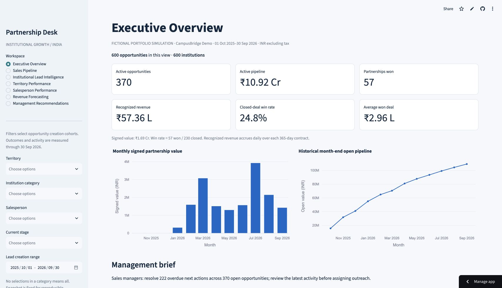

# University Partnership & Sales Pipeline Analytics

**Partnership Desk** is a working B2B EdTech sales operations portfolio by Harsh Vardhan Tomar. It helps a fictional higher-education partnership team prioritize institutional leads, monitor deal progression and plan next-quarter bookings.

**All institutions, representatives, commercial values and transactions are simulated.** No KollegeApply affiliation or real commercial result is claimed.

[Open the live interactive dashboard](https://university-partnership-sales-analytics.streamlit.app/)



## Quick start

Python 3.12 recommended.

```bash
python -m venv .venv
source .venv/bin/activate
pip install -r requirements.txt
python -m streamlit run app.py
```

On Windows activate with `.venv\Scripts\activate`. The committed SQLite database makes the dashboard usable immediately. To regenerate the same seed and refresh reporting inputs:

```bash
python -m src.generate
python -m src.export
python -m pytest -q
```

## Business questions

Which institutions should receive outreach next? Where do deals stop advancing? Which follow-ups are overdue? How much of the pipeline can plausibly sign next quarter? Which sales territories need better coverage?

## Seven dashboard pages

Executive Overview; Sales Pipeline; Institutional Lead Intelligence; Territory Performance; Salesperson Performance; Revenue Forecasting; Management Recommendations. Shared territory, institution type, representative, stage and creation-date filters apply to each view. CSV downloads, lead search and forecast sensitivity controls work without external APIs.

## Verified dataset scope

600 fictional institutions and opportunities, 4,399 activities, 1,971 stage entries, 57 contracts, 15 states/UTs, six territories, eight representatives and 12 months (October 2025–September 2026). Deterministic seed: 20261017.

At 30 September 2026: 370 open opportunities, INR 109,230,000 open pipeline, INR 16,886,000 signed value, INR 5,736,156.17 accrued revenue. Closed-deal win rate: 57 / 230 = 24.78%. Next-quarter base forecast: INR 4,911,800 across 108 eligible open opportunities. These are simulated findings, not delivered business improvements.

## Architecture and reproducibility

`src/generate.py` produces relational source CSVs and constrained SQLite tables. `src/model.py` owns KPI, scoring, funnel and scenario logic. `src/load.py` loads the reporting mart read-only. `app.py` renders the dashboard. `src/export.py` produces report inputs and the dictionary. Core tests include independent SQL reconciliation and edge-case fixtures.

Institutions 1 → many opportunities; opportunities 1 → many activities and stage events; opportunities 1 → zero/one contracts. This dataset intentionally has one opportunity per institution. The reporting mart has one row per opportunity to prevent activity joins from inflating revenue. Database schema: [sql/schema.sql](sql/schema.sql). Fourteen annotated analytical queries: [sql/queries.sql](sql/queries.sql).

## Documentation and deliverables

- [KPI definitions](docs/KPI_DEFINITIONS.md), [data dictionary](docs/DATA_DICTIONARY.md), [scoring methodology](docs/SCORING.md), [source investigation](docs/SOURCES.md)
- [Excel workbook](reports/Partnership_Analytics.xlsx), [leadership presentation](reports/Management_Strategy.pdf), [partnership proposal](reports/Institutional_Partnership_Proposal.pdf) and [sales review](reports/Sales_Performance_Review.pdf)
- 28 automated tests passed, including workbook reconciliation; [test output](reports/test_results.txt)
- [Live deployment verification](docs/LIVE_VERIFICATION.md) and actual dashboard screenshots in `screenshots/`. Deployed by Harsh Vardhan Tomar; live navigation and key controls verified on 18 October 2026.
- [Interview guide and resume entry](docs/INTERVIEW_GUIDE.md)
- [Verification and deployment checkpoint](docs/DELIVERY_STATUS.md)

## Interpretation limits

Scores are heuristics, not ML predictions. Forecasts use stage assumptions and are not confidence intervals. No predictive accuracy is claimed for synthetic outcomes. Observed funnel rates are affected by unfinished recent cohorts. Signed value, accrued revenue and cash collection differ. Payment labels do not establish cash receipts. The simulator includes deliberately stale deals; expansion rankings do not represent real market size. Dashboard is a read-only analytics application, not a persistent editing CRM or production security system.

## Workbook and report refresh

Run the two Python commands above, then follow `docs/ARTIFACT_REFRESH.md`. The committed workbook supports native Excel formula recalculation and editable scenario multipliers. Source-data refresh is a rebuild, not a live connection. The app never needs the artifact authoring environment.

## License

Code, original documents and synthetic data: MIT, see LICENSE. Third-party dependencies retain their own licenses. No external institution database is redistributed.
